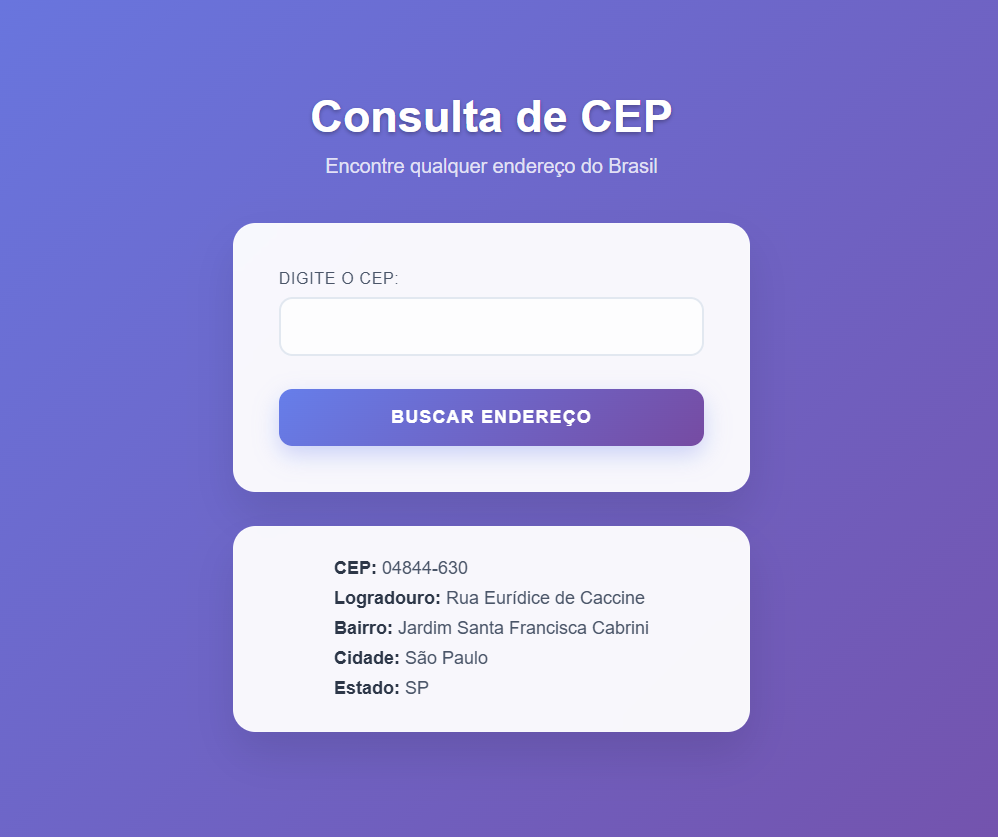

# Consulta de CEP

Uma aplicação web para localizar endereços brasileiros por meio do CEP. O projeto valida o valor informado, consulta a API ViaCEP e apresenta os dados do endereço na tela.

## Demonstração

[](https://gabrielmatheus1.github.io/Consulta-CEP/)



## Funcionalidades

- Consulta de CEPs brasileiros pela API ViaCEP
- Remoção automática de caracteres não numéricos
- Validação de campo vazio
- Validação de CEP com oito dígitos
- Mensagem de erro para CEP inexistente
- Exibição de CEP, logradouro, bairro, cidade e estado
- Limpeza do campo após uma consulta concluída

## Tecnologias

- HTML5
- CSS3
- JavaScript
- Fetch API
- ViaCEP

## Como funciona

1. O JavaScript captura o valor digitado e mantém apenas os números.
2. A aplicação verifica se o CEP contém oito dígitos.
3. Uma requisição é enviada para `https://viacep.com.br/ws/{cep}/json/`.
4. A resposta é convertida para JSON.
5. Os dados do endereço ou uma mensagem de erro são exibidos na interface.


## Estrutura do projeto

```text
Consulta-CEP/
├── index.html
├── src/
│   ├── icon.png
│   ├── preview.png
│   ├── script.js
│   └── style.css
└── README.md
```

## API utilizada

A consulta é realizada com a API pública [ViaCEP](https://viacep.com.br/).

Exemplo de rota:

```text
https://viacep.com.br/ws/01001000/json/
```

## Aprendizados

Este projeto foi desenvolvido para praticar:

- Requisições assíncronas com `fetch`, `async` e `await`
- Consumo de uma API REST
- Validação e tratamento de dados digitados
- Manipulação do DOM
- Renderização de respostas JSON


## Autor

Desenvolvido por [Gabriel Izidoro](https://github.com/GabrielMatheus1).
